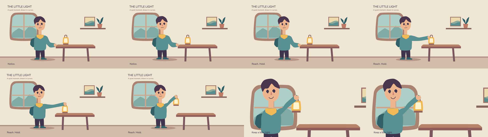

# AETHER Fx


**Write 2D animation as `.afx` source, play it on Canvas, and export it to video.**

AETHER Fx is an experimental declarative animation language with a TypeScript runtime. Define cubic shapes, character parts, poses and shots, then animate them with keyframes, morphs and drawing changes. The same compiled plan supports browser playback, React integration and offline rendering in Node.js.



[*The Little Light*](fixtures/short/little-light.afx) is a 20-second character animation with layered backgrounds, hand/object parenting, expressions, typography and stereo audio. The image above is historical; current reference renders and continuity checks are included in the candidate evidence.

## Quickstart

Use Node 22.12 or newer. From a clean checkout, these three commands start the demo:

```sh
npm ci
npm run build
node examples/browser/serve.mjs
```

Open http://127.0.0.1:3000, click Play for audio and scrub the timeline. Browser export is enabled by actual capability probes. No external FFmpeg is needed for preview.

A complete ten-line, asset-free example:

```afx
project hello {
 viewport:(640,360); fps:(24,1);
 shape dot {primitive:circle; radius:30;}
 part dot {shape:@dot; material:{fill:"#2563eb";};}
 actor dot {parts:[@dot]; transform:{x:80;y:180;};}
 scene movie {shot move {duration:2s;
  key a {target:@dot;property:x;frame:0f;value:80;easing:ease-in-out;}
  key b {target:@dot;property:x;frame:47f;value:560;}
 }}
}
```

Save as `hello.afx`, then run `node packages/cli/dist/afx.js check hello.afx --json`. Times support `f`, `s` and `ms`; rational conversion avoids accumulated decimal drift. Source contains data, not executable JavaScript.

## Export and tools

Node video export renders with Skia and streams frames to separately installed FFmpeg. Chromium is an explicit compatibility renderer (`--backend chromium`), installed with `npx --no-install playwright install chromium`. Install FFmpeg with libvpx-vp9/libopus for WebM and libx264/aac for MP4. Run `afx doctor` to diagnose installation. The integrated NodeAV encoder is isolated at `@aether-fx/node/integrated`, with optional peers and binary-distribution qualification pending; it is absent from the default install.

```sh
node packages/cli/dist/afx.js probe mp4
node packages/cli/dist/afx.js render hello.afx --out hello.webm
node packages/cli/dist/afx.js render hello.afx --out hello.mp4 --format mp4
```

Output paths must be new. WebM remains the default. Browser MP4 depends on AVC support; the optional `@aether-fx/export/aac` entry supplies measured AAC WASM encoding when native AAC is unsuitable. Read [export capabilities and limits](docs/export-v0.1.md).

`afx` also provides `fmt`, `expand`, `fix --safe`, `scene`, `hash`, `bench` and `lsp`. [Tooling](docs/tooling.md) explains the static playground, TextMate grammar and LSP. The playground builds with `npm run playground:build`; serve `artifacts/playground/` through a local static server.

## Packages and API

Seven ESM packages are prepared as local archives, with no npm publication. See [local archive installation](docs/quickstart.md#install-local-packages-in-another-project), the [API reference](docs/api.md) and the release manifest/checksums.

| Package | Purpose |
| --- | --- |
| `@aether-fx/core` | Pure frame evaluation, documents, serialization and structured edits |
| `@aether-fx/compiler` | Bounded `.afx` parsing, expansion and diagnostics |
| `@aether-fx/canvas` | Browser rendering and playback |
| `@aether-fx/react` | React/Next integration |
| `@aether-fx/export` | Browser WebM/MP4 and optional AAC encoding |
| `@aether-fx/node` | Verified local assets, Skia rendering and external FFmpeg video export |
| `@aether-fx/cli` | Authoring, validation, scene generation and export commands |

`evaluate(plan, {frame:97})` derives state without wall time, implicit randomness or previous frames. State determinism does not imply identical pixels across platforms. Backends declare their measured raster tolerances.

Public vector authoring now includes projected convex solids and cylinders, editable node handles, centripetal curves, local linear/radial fills, vector clipping and absolute-frame contact intervals. See the [syntax and bounds](docs/language-v0.1.md#public-projected-solids-editable-curves-and-contact), the [authored Little Light](fixtures/short/little-light-authored.afx), and the [guide carriage assembly](fixtures/assembly/guide-carriage.afx). The historical short remains available for regression comparison. The playground can overlay nodes/handles, pivots/anchors and layer order and export critical-frame sheets.

## Learn and develop

- [Language v0.1](docs/language-v0.1.md) and [compatible v0](docs/language-v0.md).
- [Model authoring pack](docs/llm/reference.md): twelve complete examples and constrained decoding grammar.
- [Architecture](docs/architecture.md), [React/Next](docs/react-next.md), [performance](docs/performance-v0.1.md).
- [Known issues](KNOW-ISSUES.md), [release readiness](RELEASE-READINESS.md).

```sh
npm run check       # Metadata, build, types and current tests
npm run verify:ci   # Every acceptance gate; preserves failures
```

Full acceptance additionally requires Playwright browser builds and external FFmpeg for independent decode and the retained oracle. Local macOS results do not establish Linux or physical-device compatibility. The single register of current defects, unsupported scope and pending qualification is [KNOW-ISSUES.md](KNOW-ISSUES.md); recording a limitation does not approve a release.

Original code remains [Apache-2.0](LICENSE). [NOTICE](NOTICE), [asset provenance](fixtures/short/ASSETS.md) and [dependency licensing](docs/licensing.md) preserve third-party obligations. Dependency terms remain separate from the project license.
