# Visual history of AETHER Fx

These images record early renders of *The Little Light*, the included illustrated short. They show visual development within the experimental 0.x.x version, rather than separate published releases.

## First render

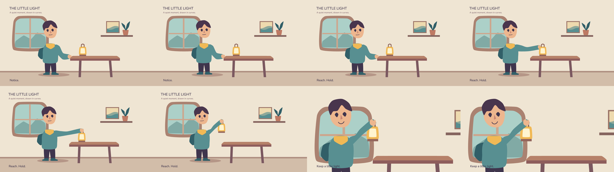

## Preview refinement

The character was later corrected with a neck bridge connecting the head and torso. The images above predate that correction. Run the [current demo](quickstart.md#preview-the-included-animation) to see the checked-in animation, or read [release readiness](../RELEASE-READINESS.md#corrected-acceptance-short) for the correction and its recorded verification.

## Redesing the Render, introduce the Render 3D

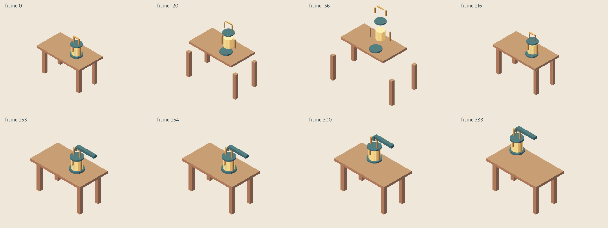

## Before and After

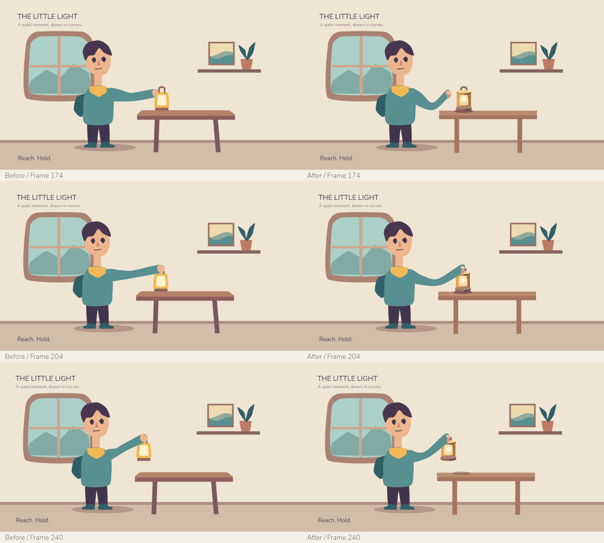

## Articulated reach and a visible grip

The [authored short](../fixtures/short/little-light-authored.afx) now uses fixed-contour upper and forearm parts with authored rotations, coordinated head/torso poses and planted feet. Open, closing and holding hand drawings place the palm behind the handle and the fingers/thumb in front. The handle crown and curled-finger landmark lie on the drawn surfaces; matching anchors alone is not the visual acceptance criterion. The parametric table gains a clearer cap, end face and supporting apron, while the window and final caption leave room for the gesture.

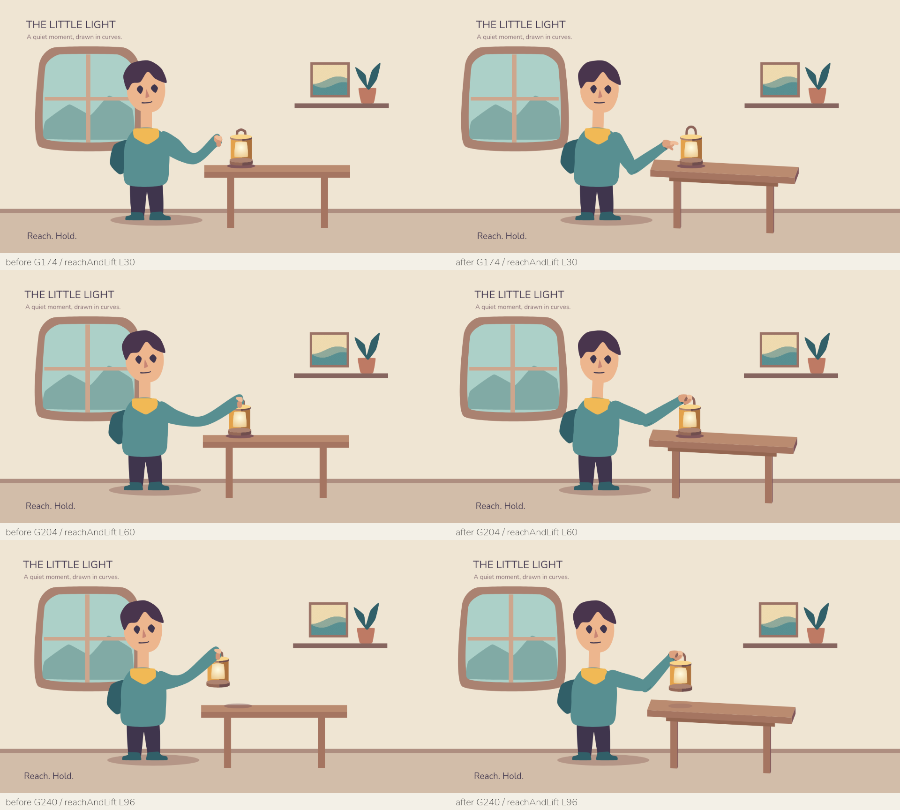

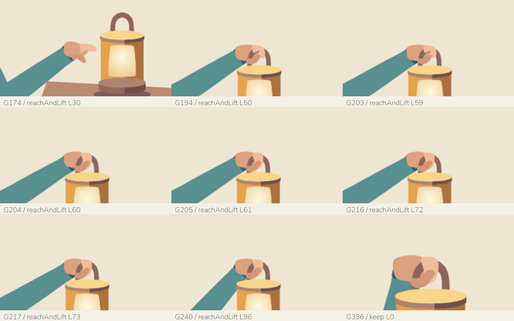

`G` labels global frames and `L` labels frames local to the named shot. G174 is `reachAndLift` L30, before contact: the open hand is still approaching. Closing begins at G194/L50, binding occurs at G204/L60, and the lamp remains supported through G216/L72 before lifting. The finger/thumb drawings show the handle being held during the lift. The final grip continues through the G336 `keep` shot boundary. A settling pose was added at G274–G298 within the existing pause; duration remains 480 frames at 24 fps, with the original audio and camera tracks.

Native MP4 decode, absolute-frame seeking and critical-frame preview/Skia comparisons were checked locally. This sheet documents progress in this short, rather than universal contact stability, all-frame raster parity or a published release.

## Goals, shared motion and a coherent room

The [editable short](../fixtures/short/little-light-authored.afx) now separates [art](../fixtures/short/little-light/art.afx), [rig/goals](../fixtures/short/little-light/rig.afx) and [sequence](../fixtures/short/little-light/sequence.afx), with visible shared [motion](../fixtures/short/little-light/motion.afx) and [lamp recipes](../fixtures/short/little-light/lamp.afx). Primitive rectangles/polygons and organic node contours replace derived cubic controls; two explicit cubics remain for the corresponding mouth morph. Tracks and parameterized clips expand to the existing absolute-frame plan. A two-segment authoring helper calculates arm rotations from hand goals and an explicit elbow choice.

The direction is a quiet paper illustration: warm light from the window, cooler shaded sleeves, a brighter lamp as the focal point, and restrained plum typography. Floor/skirting edges now share the table's projected horizontal slope. Lamp pieces use the same 22-degree elevation and 8-degree azimuth; editable silhouettes, graded skin/sleeves and a floor contact shadow give clearer joints and depth. The title hierarchy is stronger and the closing caption has more space. The lift retains anticipation, approach and a supported grip pause, then uses an analytic damped settling curve. No shader or new rendering backend is involved.

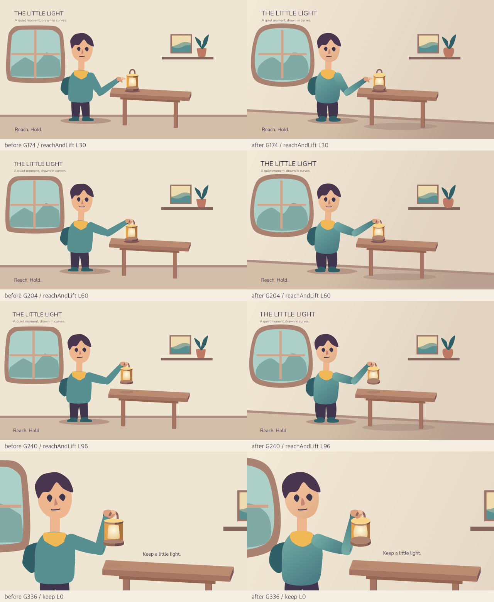

The left column was rendered from the authored successor before this revision; the right from the new modular source with the same retained font, paper and soundtrack assets. These are actual Skia renders, composed into a sheet without generated art. G174 is `reachAndLift` L30 (free approach), G204 is L60 (bind), G216 is L72 (last supported frame), and G217 is L73 (first lift movement). G336 is `keep` L0; world grip/pose continues while the authored close camera cuts. The three shot lengths and 480-frame/20-second duration at 24 fps remain unchanged. The new curiosity excursion occupies notice L24–120; settling stays in reachAndLift L130–154 with a damped response.

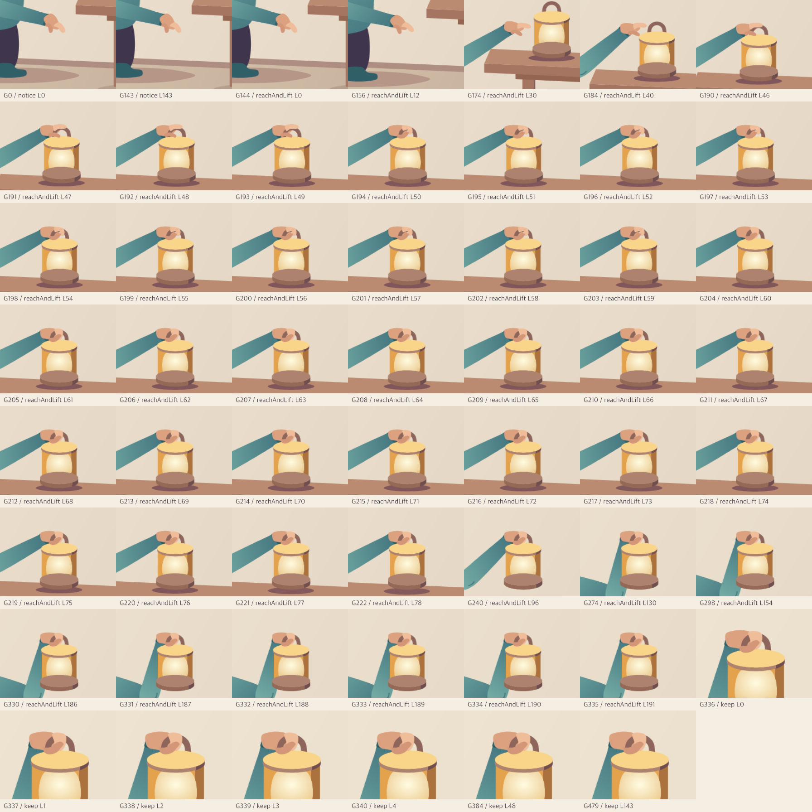

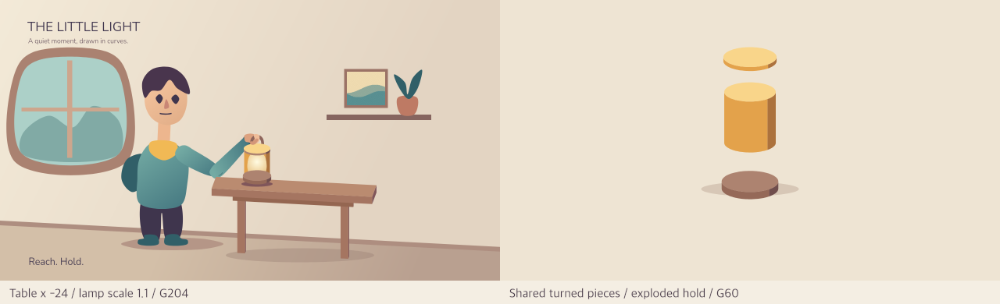

The [variation](../fixtures/short/little-light-varied.afx) moves the table left 24 units and enlarges the lamp by 10%, using the same rig and gesture clip. The [assembly](../fixtures/short/little-light-assembly.afx) imports the same turned-piece component and excursion clip, separates at G12–36, pauses through G60 and returns by G108 within 144 frames. Shared source is included in all reported metrics; there is no hidden generator or duplicate giant variation.

The design study used [Anatomy](https://skills.wheresryan.sh/anatomy) and its [parametric kit/audits](https://github.com/wheresryan22/anatomy) as references for dimensional coherence, one light direction and enlarged joint review. No Anatomy code or assets were copied. Local checks cover all 1104 scene frames for seeking, 121 sampled Chromium/Skia raster comparisons, original-source diagnostics, grip/feet/shot boundaries and independent decode. These reviewed images record visible progress, not a release or universal artistic/platform qualification. See [language contracts](language-v0.1.md#compact-tracks-reusable-clips-and-modules), [measurements](performance.md#modular-authoring-and-owned-geometry-copies-2026-10-11) and [remaining limitations](../KNOW-ISSUES.md#ki-12--vector-authoring-and-projected-assemblies).

## Shared rig and contained silhouettes

The [editable short](../fixtures/short/little-light-authored.afx) now authors nine hand goals through one [arm component](../fixtures/short/little-light/rig.afx), keeping existing pose, actor and track IDs. The [art module](../fixtures/short/little-light/art.afx) shares materials, replaces five static node contours with primitives, clips the landscape to its window, shortens the neck proportion and adds a restrained window light plane with denser sole contact shadows. The table and lamp retain their shared 8-degree azimuth and 22-degree elevation; no renderer or shader changes are involved.

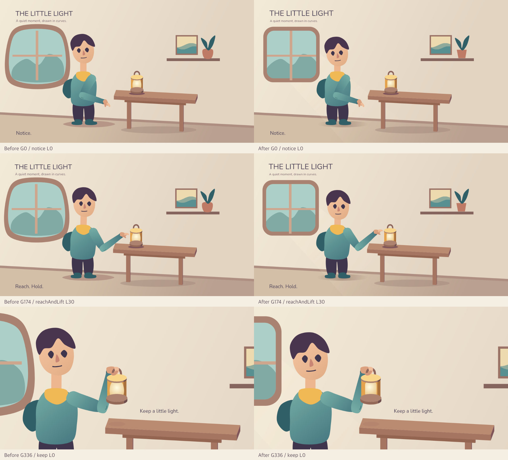

Anticipation pulls the wrist back farther; the approach rises into an arc before descending to a near pose six units from the crown. The hand remains free before binding at G204/reachAndLift L60. Support continues through G216/L72, followed by lift and the existing analytic settling response. Shot lengths, bind/lift timing, the G336 close camera cut and 480-frame duration are unchanged. The PNGs below cover every frame G140–148, G190–222 and G330–340, plus approach, lift and settling samples; separate full-frame sheets also reviewed the first-shot boundary; camera scale changes at the close shot, while world contact remains continuous.

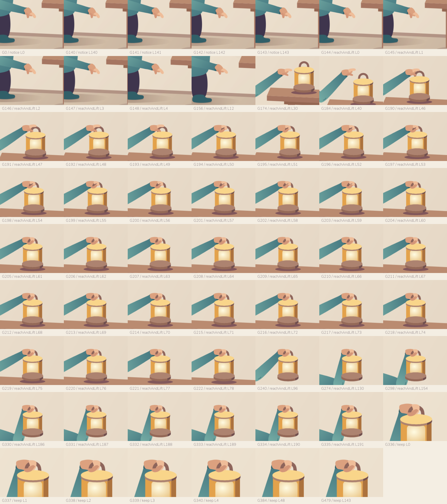

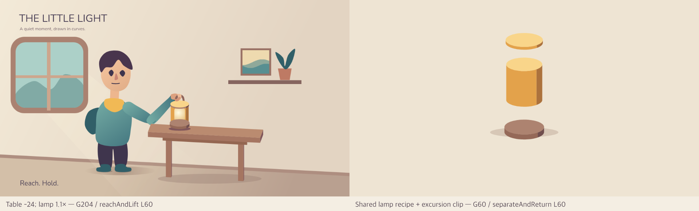

The [dimensional variation](../fixtures/short/little-light-varied.afx) still uses the same art/rig/motion with a table offset of -24 and lamp scale 1.1. The [assembly](../fixtures/short/little-light-assembly.afx) uses the same turned-piece component and excursion clip. All their required source is counted in the [metrics](performance.md#shared-arm-recipe-and-silhouette-refinement-2026-10-11). The before images were rendered from the current checkout before editing; after images are native PNGs from the verified successor. Original assets and earlier history images remain intact.

[Anatomy](https://skills.wheresryan.sh/anatomy) and its [craft, motion and verification references](https://github.com/wheresryan22/anatomy/tree/main/references) informed dimensional coherence, restraint and enlarged joint inspection; no code or media was copied. The complete reviewed MP4 was played through its 20-second end without a player error; critical PNGs, variation/assembly sheets and an independent decoded movie sheet were inspected. Seeking/contact and sampled Chromium/Skia parity are separate technical evidence, not artistic or universal platform qualification. See [remaining limitations](../KNOW-ISSUES.md#ki-12--vector-authoring-and-projected-assemblies).
